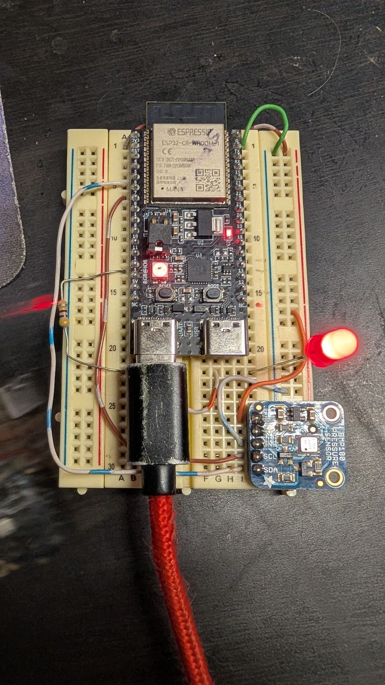

# ztoit — the Toit VM on Zephyr

A port spike: the [Toit](https://toitlang.org) v2.0.0 virtual machine running as a Zephyr application.

**What the spike shows:**

- **The Toit interpreter runs on Zephyr**, on five SoCs (weakest first):

  | SoC (CPU) | Link shown | IP | Toit heap | RAM | C heap | Program space | Runs from flash | Installs over the air |
  |---|---|---|---|---|---|---|---|---|
  | ESP32 WROOM-32 (Xtensa LX6) | WiFi | IPv4 | 44 KB | 192 KB + 96 KB, two banks | ~85 KB | 2.2 MB | yes | yes |
  | ESP32-C6 (RISC-V) | Thread | IPv6 | 160 KB | 427 KB, one region | ~90 KB | 4 MB | yes | yes |
  | nRF52840 (Cortex-M4) | Thread | IPv6 | 80 KB | 256 KB, one region | ~72 KB | 240 KB | yes | no |
  | nRF54L15 (Cortex-M33) | Thread; Bluetooth LE, via a phone relay | IPv6 (BLE: UDP only) | 80 KB | 256 KB, one region | ~85 KB (BLE build) | 588 KB | yes | yes (Thread) |
  | RP2350B (Cortex-M33) | none | — | 160 KB | 520 KB, one region | ~197 KB | 128 KB, in RAM | no | no |

  - "Link shown" is what ztoit has run on the board, not everything the chip has: the C6 also has WiFi, which
    ztoit has not built. A build carries one link, and its sockets take that link's family.
  - "Toit heap" is the arena Toit objects and task stacks live in, a build setting (`CONFIG_TOIT_HEAP_SIZE`).
    "C heap" is the RAM left after the firmware's static data, thread stacks, the Toit heap and, on the
    WROOM-32, WiFi's own 54 KB heap; Toit's thread stacks and garbage-collector tables come out of it.
  - The WROOM-32 is the tightest: its second 96 KB bank is fully assigned to the thread stacks and the Toit
    heap (312 B unassigned), so the Toit heap cannot grow. 100 sleeping tasks do not fit in it (#3).
  - Measured on the builds in use: the WROOM-32 (WiFi + agent) 2026-11-22 and the nRF54L15 (push to talk)
    2026-11-21 on Zephyr 4.5; the C6 (Thread + agent), the nRF52840 dongle (Thread soak) and the RP2350B
    (benchmark) 2026-11-17 on Zephyr 4.2, not yet re-measured on 4.5.

  Stock Toit needed one VM change, in the flash registry; the rest is new Zephyr platform code, plus the
  `zephyr` primitive module (appended after the stock modules, so a forked compiler is needed for now).
- **Programs run from flash in place (XIP)**, installed in a flash registry (the RP2350B installs into RAM:
  Zephyr has no flash driver for its QSPI controller yet).
- **IPv6 UDP and TCP over OpenThread** from Toit's `net` library, on the C6, the nRF52840 and the nRF54L15; the nRF52840
  dongle runs a UDP + TCP echo soak on a wall wart.
- **IPv4 over WiFi** on the WROOM-32: the station associates on the first `net.open` and disconnects after
  the last close; `zephyr/toit/wifi_echo.toit` does a UDP echo each cycle. The image holds no WiFi credentials.
- **UDP over Bluetooth LE** on the XIAO nRF54L15 Sense: each datagram crosses one L2CAP channel to a bonded
  phone, which sends it on as real UDP. Toit's `net` library is unchanged; `udp_ble.cc` sits beside
  `udp_zephyr.cc` in the fork.
- **Push to talk** on the nRF54L15 (with [ktau](https://github.com/davidg238/ktau)): the board's PDM microphone
  through Zephyr's `dmic` driver, LC3-encoded, streamed over BLE to a speech-to-text and LLM host, and the reply
  back. Write-up: [Push to talk](https://ekorau.com/push-to-talk-toit-tailnet-llm-and-back/).
- **Containers installed over the air**, on the WROOM-32 (WiFi), the C6 and the nRF54L15 (Thread): a C agent checks in with
  a gateway over CoAP, fetches a signed image, verifies it (SHA-256, ed25519) and installs it at the next
  boot, beside the containers built into the firmware (#31).
- **At least as fast as stock Toit** on a simple benchmark ([STIC](https://github.com/davidg238/performance_stic), same ESP32-C6, v2.0.0 both sides):
  interpreter-bound rows match, allocation-heavy rows are 1.2–2.2× faster (cause not yet measured, #2).
  STIC on all three CPUs: `spike/step4/`.
- **Peripherals come from Zephyr's drivers**, named by devicetree label, not Toit rewrites: `import ztoit`
  (`Sensor`, `Led`, `LedStrip`, `Key`), one primitive module generic over Zephyr's device classes (#7). On the
  C6: a BMP180 over I2C, the BOOT button (debounced input events), an output pin and the on-board RGB LED;
  BOOT and the RGB LED need no wiring. On the nRF54L15: the LED, the PDM microphone (`Microphone`), an LC3
  encoder (`Lc3Encoder`) and a generic I2C bus (`I2c`), which ktau's IMU tap driver uses from Toit.

Not yet: DNS, uninstall, the console sent to the gateway, raw `gpio`/`spi`; known issues are on GitHub.

The VM changes live in the Toit fork's
[`zephyr-port`](https://github.com/davidg238/toit/tree/zephyr-port) branch; this repo holds the Zephyr module
(`modules/toit/`), the application (`zephyr/`), and the measurements (`spike/`). The backend seams come from
[rete](https://github.com/davidg238/rete).

## What works (2026-11-21)

| Step | Result | Record |
|---|---|---|
| 0 | Stock Toit v2.0.0 baseline on the same board | [`spike/baseline/`](spike/baseline/) |
| 1 | VM core boots under Zephyr; STIC benchmark at least as fast as stock on every row | [`spike/step1/`](spike/step1/) |
| 2 | Programs installed in a flash registry and run in place (XIP); UDP over IPv6 on Thread | [`spike/step2/`](spike/step2/) |
| 3 | `net.open` provider; TCP over IPv6 on Thread | [`zephyr/toit/tcp_echo.toit`](zephyr/toit/tcp_echo.toit) |
| 4 | Second SoC: nRF52840 dongle runs Toit from its flash registry, UDP + TCP over Thread (soak) | [#6](https://github.com/davidg238/ztoit/issues/6) |
| 5 | Third SoC: RP2350B (RAM registry); STIC on all three CPUs | [`spike/step4/`](spike/step4/) |
| 6 | Zephyr devices from Toit: BMP180, BOOT key, output pin, RGB LED on the C6 | [`zephyr/toit/io.toit`](zephyr/toit/io.toit), [#7](https://github.com/davidg238/ztoit/issues/7) |
| 7 | Fourth SoC: ESP32 WROOM-32 over WiFi (IPv4), credentials from the settings store | [#25](https://github.com/davidg238/ztoit/issues/25), [#30](https://github.com/davidg238/ztoit/issues/30) |
| 8 | Signed containers installed over the air, WiFi and Thread; run-once and replace | [#31](https://github.com/davidg238/ztoit/issues/31) |
| 9 | Fifth SoC: XIAO nRF54L15 on Zephyr 4.5; UDP over BLE, microphone, LC3, I2C; push to talk | [#41](https://github.com/davidg238/ztoit/issues/41) |
| 10 | XIAO nRF54L15 on Thread: the agent checks in, and `faber install` puts a signed container on it over the air | [#51](https://github.com/davidg238/ztoit/issues/51) |

Design decisions: `docs/design/zephyr-port.md`. Known issues and open work: GitHub issues.

## Build

Needs Zephyr 4.5 with the Zephyr SDK 1.0.1, the [Toit SDK v2.0.0](https://github.com/toitlang/toit/releases/tag/v2.0.0)
for the host compiler, and an ESP32-C6 board, an ESP32 (WROOM-32) board, an nRF52840 dongle, a XIAO nRF54L15 or an
RP2350B board. The RP2350B has not been rebuilt since the move from Zephyr 4.2.

    west init -m https://github.com/davidg238/ztoit ztoit-ws && cd ztoit-ws && west update
    west blobs fetch hal_espressif && west packages pip --install
    # nRF boards: (cd zephyr && git apply ../ztoit/patches/zephyr-nrf-802154-hfclk-ready-deferred.patch)  (#23)
    export ZEPHYR_BASE=$PWD/zephyr TOIT_SRC=$PWD/toit
    # Unpack the Toit SDK to ~/.local/state/ztoit/sdk/toit, then build the fork's compiler (it knows the
    # `zephyr` primitives; needs cmake and ninja) into an SDK with the fork's lib/:
    export TOIT_HOST=$(ztoit/tools/fork-sdk.sh)
    west build -b esp32c6_devkitc/esp32c6/hpcore -d build ztoit/zephyr -- -DCONTAINERS="$PWD/ztoit/zephyr/toit/hello.toit"
    west flash -d build

nRF52840 dongle: `west build -b nrf52840dongle/nrf52840 -d build-nrf ztoit/zephyr`, press the dongle's RESET
button, then `ztoit/tools/nrf-flash.sh build-nrf` (needs `nrfutil` with `nrf5sdk-tools`). Console is USB CDC ACM;
the app waits up to 3 s for the host to open it, then runs anyway.

RP2350B (WeAct core, rete's out-of-tree board): `west build -b weact_rp2350b_core/rp2350b/m33 -d build-rp
ztoit/zephyr -- -DBOARD_ROOT=<rete>/nodus/oevm/zephyr`, then copy `build-rp/zephyr/zephyr.uf2` to the board in
BOOTSEL mode. Console is USB CDC ACM. The RNG is Zephyr's non-cryptographic timer generator (benchmarks only).

XIAO nRF54L15 (Zephyr 4.5): `west build -b xiao_nrf54l15/nrf54l15/cpuapp -d build-xiao ztoit/zephyr --
-DEXTRA_CONF_FILE=prj_ble.conf`, then `west flash -d build-xiao` over the board's USB (CMSIS-DAP, OpenOCD).
A relay (rete's Pixel app) bonds once, Just Works, and forwards the UDP. For Thread instead, use the Thread and
agent confs below in place of `prj_ble.conf`.

Thread: copy `zephyr/prj_thread.local.conf.example` to `prj_thread.local.conf`, fill in your network's
dataset, and add `-DEXTRA_CONF_FILE="prj_thread.conf;prj_thread.local.conf"` (C6, nRF52840 or nRF54L15). The node joins on
the first `net.open`, and after the last close stays attached as a sleepy end device
(`-DCONFIG_TOIT_THREAD_DOWN_DETACH=y`: disables Thread instead).

WiFi (WROOM-32, `-b esp32_devkitc/esp32/procpu`): add `-DEXTRA_CONF_FILE="prj_wifi.conf"`. The image carries no
network name or passphrase: the node connects to the one network in its settings store (Zephyr's
`wifi_credentials`, in the `storage` partition, which an app flash leaves alone), written at flash time by a
host tool (#30). With the store empty, `net.open` throws `FILE_NOT_FOUND`. DHCP, IPv4.

Agent (optional, WiFi or Thread): add `prj_agent.conf` and a git-ignored local conf (`prj_wifi.local.conf` or
`prj_thread.local.conf`, see the `.example` files) with the gateway's address and its public signing key. At
each `net.open` the agent checks in over CoAP; a signed container image named by the gateway is fetched into a
staging partition, verified (SHA-256, ed25519), and installed into the registry at the next boot (#31;
`docs/design/2026-11-15-nodus-toit-design.md`). Shown on the WROOM-32 over WiFi and the ESP32-C6 and XIAO nRF54L15 over Thread.
The host tool must build images with the same SDK the firmware reports: `tools/sdk-id.sh` prints that identity
(`v2.0.0+zephyr.<fork commit>`), and `tools/fork-sdk.sh` stamps it into `$TOIT_HOST version`, so rerun it after
changing the fork.

## License

ztoit's own code is Apache-2.0 (`LICENSE`), matching Zephyr. The Toit sources it builds keep their licenses:
the VM is LGPL-2.1 and the Toit libraries are MIT (see the Toit fork).
